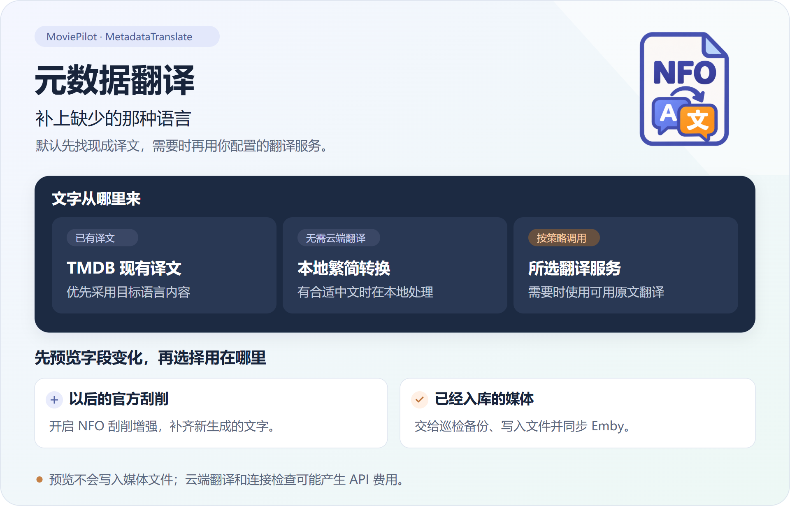

# 元数据翻译 MetadataTranslate

有些影片在 TMDB 上只有英文简介，有些只有繁体中文，刮削后的 NFO 因而缺少想要的语言。元数据翻译会先找已有译文，按策略做繁简转换；需要机器翻译时，再把可用原文交给你配置的服务。

适用于 MoviePilot V3（3.2.5 及以上），当前版本 1.1.4。可以增强以后生成的 NFO，也可以配合巡检处理已经入库的媒体。

## 哪些内容可以补齐

默认处理剧情简介和简短摘要，标题、宣传语可以按需开启。电影、整剧、季和单集都能配置；季和单集不处理宣传语。

默认先采用 TMDB 中已有的目标语言文字，再按策略顺序寻找备用语言。选择“仅来源补齐”时，只使用已有文字和本地繁简转换，不调用云端翻译。来源没有可用原文时，会保留字段并记录原因。

| 使用方式 | 适合的情况 |
| --- | --- |
| 独立预览 | 先看某部影片的字段会如何变化，不写入媒体文件 |
| 官方刮削增强 | 在以后由 MoviePilot 官方刮削生成 NFO 时补齐文字 |
| 配合元数据巡检 | 批量处理现有 NFO，由巡检负责备份、写入、续跑和 Emby 同步 |

## 安装

在 MoviePilot 插件市场添加仓库 `https://github.com/JKRaks/mpp-nfotrans`，安装“元数据翻译”。插件标识为 MetadataTranslate，仓库包含当前版本的完整前端产物。

需要云端翻译时，请准备所选服务的 API Key。个人设置和密钥保存在自己的 MoviePilot 中，不随仓库或安装包提供。

## 第一次使用

1. 启用插件。需要机器翻译时，在“服务设置”选择当前服务，填写密钥及所需的模型信息，再检查连接。仅做来源补齐时，可以直接配置策略。
2. 在“翻译策略”选择“简体中文补全”“繁体中文补全”或“仅来源补齐”模板。默认目标语言是简体中文，字段是简介和摘要；标题、备用语言顺序等可以展开后调整。
3. 到“预览”填入明确的 TMDB 身份和 NFO 内容，生成结果后对照原文与候选文字。连接检查和云端翻译预览可能产生 API 费用，预览本身不会写媒体文件。
4. 确认结果后，按用途开启“官方刮削增强”，或到元数据巡检中选择这套翻译策略。

如果修改尚未保存，连接检查和预览按钮会提示“保存并检查连接”或“保存并生成预览”，使用刚保存的配置执行。

## 翻译服务怎么选

| 服务 | 需要准备什么 |
| --- | --- |
| DeepL | API 密钥，以及对应的 Free / Pro 套餐 |
| 硅基流动 · Hunyuan-MT | 硅基流动密钥，默认模型为 Hunyuan-MT-7B |
| OpenRouter | API 密钥和要使用的模型 ID |
| Gemini API | Google AI Studio 密钥和模型 ID |
| 通用 Chat Completions | 完整接口地址、API 密钥和模型 ID |

所有策略共用当前选择的服务。其他服务的配置可以保存起来，使用时手动切换；请求失败后，插件会记录原因，不会自动更换服务或模型。

高级参数只需在需要时展开。各服务的地址、响应格式和请求上限见[详细配置说明](plugins.v3/metadatatranslate/README.md)。

## 日常使用时要留意什么

页面顶部显示运行状态和未保存提示，配置修改后统一保存。策略以摘要卡片显示，可以从模板添加、复制已有策略，或选择默认策略。删除默认策略前需要选一个替代项。如果巡检规则引用了被删除的策略，也要到巡检中调整。

预览会直接显示字段前后的变化和处理结果。调用记录可以单条或批量删除；删除记录不会清理译文缓存、媒体备份或巡检待办。缓存和记录的保留时间在“请求与缓存”中设置。

插件默认保留无法确认来源或已经手工修改的文字。重新翻译可以绕过译文缓存，但仍保留这项保护。缺少原文、接口失败或输出被截断时，会记录原因，不把不完整的结果写入 NFO。

[元数据巡检](https://github.com/JKRaks/mpp-nfochecker)负责已有媒体的修复和 Emby 同步。翻译插件生成候选文字，预览中显示完成并不表示媒体文件已更新。只想增强以后的官方刮削，可以单独使用翻译插件；若其他插件也接管了同一 NFO 入口，页面会提示冲突并暂停这项增强。

## 下载安装包

已发布的 ZIP 和 SHA256 校验文件在 [Releases](https://github.com/JKRaks/mpp-nfotrans/releases)。

最新构建可以从 [Actions](https://github.com/JKRaks/mpp-nfotrans/actions/workflows/package.yml) 成功运行记录的 Artifacts 下载，附件保留 30 天。
