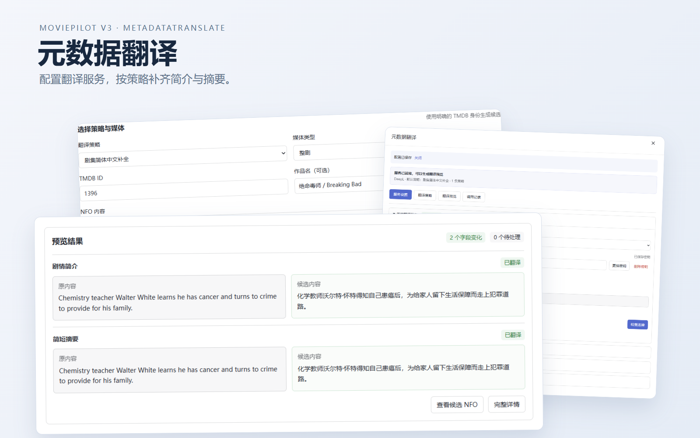
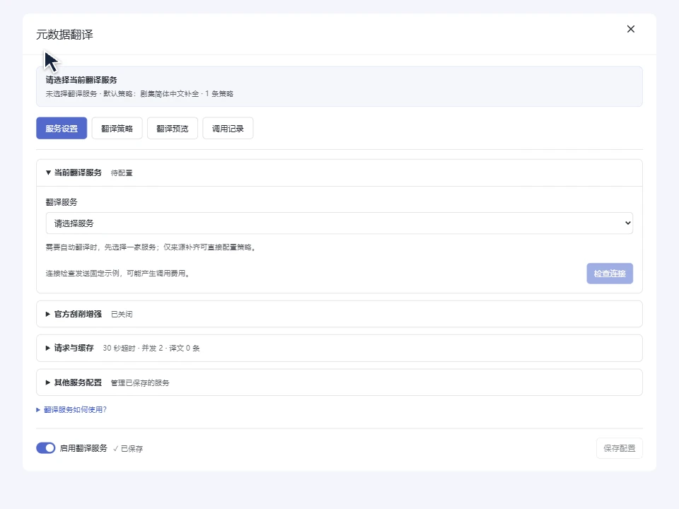
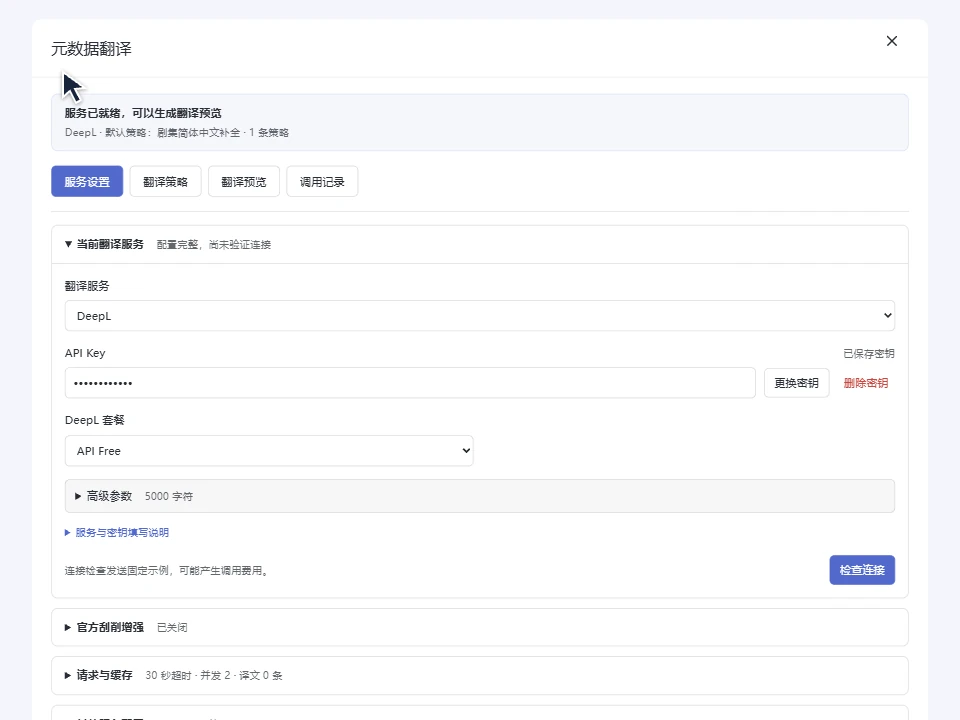

# 元数据翻译 MetadataTranslate

为 MoviePilot 的 NFO 补齐缺失语言。优先采用 TMDB 已有译文，支持本地繁简转换；需要机器翻译时，再调用你配置的服务。



适用于 **MoviePilot V3 3.2.5 及以上**，当前版本 **1.1.4**。

[安装](#安装) · [使用说明](#使用说明) · [翻译服务](#翻译服务) · [常见问题](#常见问题) · [下载安装包](#下载安装包)

## 能做什么

默认补齐剧情简介和简短摘要，标题、宣传语可以按需开启。支持电影、整剧、季和单集，季和单集不处理宣传语。

| 用法 | 处理范围 |
| --- | --- |
| 独立预览 | 对比原文与候选文字，不写入媒体文件 |
| 官方刮削增强 | 补齐以后由 MoviePilot 官方刮削生成的 NFO |
| 配合[元数据巡检](https://github.com/JKRaks/mpp-nfochecker) | 处理现有 NFO，由巡检负责备份、写入、续跑和 Emby 同步 |

只需要已有译文和繁简转换，可以使用“仅来源补齐”策略，不必配置云端翻译服务。没有可用原文时，插件保留字段并记录原因。

## 安装

在 MoviePilot 插件市场添加仓库：

```text
https://github.com/JKRaks/mpp-nfotrans
```

安装“元数据翻译”，打开插件页面。插件标识为 `MetadataTranslate`，仓库已包含前端产物，无需自行构建。

## 使用说明

以下图片使用真实前端组件，以《绝命毒师》Breaking Bad（TMDB `1396`）为例。剧集身份来自 [TMDB](https://developer.themoviedb.org/reference/search-tv)，简介按其剧情整理为演示短文。密钥、连接检查和翻译响应为本地模拟，不代表实际调用结果；媒体文件不会被修改。

### 1. 配置翻译服务

启用插件，在“服务设置”选择服务，填写 API Key 和对应参数，再检查连接。DeepL 需要选择与密钥对应的 Free / Pro 套餐；其他服务通常还需要模型 ID。



连接检查会发送一段固定示例，可能产生 API 费用。如果只做来源补齐和繁简转换，可以跳过服务配置。

### 2. 添加翻译策略

在“翻译策略”点击“从模板添加”，选择简体中文补全、繁体中文补全或仅来源补齐。创建后可以修改名称、目标语言、处理模式和媒体范围。

默认字段为剧情简介和简短摘要。展开“高级选项”，可以添加备用语言、调整查找顺序。`original` 表示作品原语言。



所有策略共用当前选择的翻译服务。默认策略用于官方刮削增强；预览和元数据巡检可以另外选择策略。配置修改后需要保存。

### 3. 对照预览结果

打开“翻译预览”，选择策略和媒体类型，填写 TMDB ID 与 NFO 内容。季和单集使用整剧的 TMDB ID，并补充季号、集号。

图中选择“整剧”，填写 TMDB ID `1396`，对照英文简介和中文候选。演示短文并非来源原文，因此在高级选项中允许本次替换本地文字；使用自己的 NFO 时，确认需要替换后再开启。这里模拟需要翻译的情况，不表示 TMDB 缺少这部剧的中文简介。

点击“生成预览”，查看各字段的原内容、候选内容和处理结果。需要检查 XML 时，可以打开“查看候选 NFO”。


预览不写入媒体文件，但可能调用收费接口并保存缓存。有未保存的配置时，按钮会显示“保存并生成预览”，使用刚保存的配置执行。

### 4. 选择应用方式

补齐以后的官方刮削：在“服务设置”展开“官方刮削增强”，开启“增强官方 NFO 刮削”，选择默认策略并保存。这个入口不会批量修改已有文件。

修复已经入库的媒体：在[元数据巡检](https://github.com/JKRaks/mpp-nfochecker)中配置语言检查条件和翻译动作，选择对应策略。先试运行，确认待处理内容及备份设置，再执行修复。

如果其他插件也接管了同一个 NFO 入口，页面会提示冲突并暂停官方刮削增强，巡检中的显式翻译仍可使用。

## 翻译服务

| 服务 | 需要准备 |
| --- | --- |
| DeepL | API Key、对应的 Free / Pro 套餐 |
| 硅基流动 · Hunyuan-MT | API Key，默认模型 `tencent/Hunyuan-MT-7B` |
| OpenRouter | API Key、模型 ID |
| Gemini API | Google AI Studio API Key、模型 ID |
| 通用 Chat Completions | 完整 `/chat/completions` 地址、API Key、模型 ID |

其他服务的配置可以保留，需要时手动切换当前服务。请求失败后，插件会记录原因，不会自动更换服务或模型。

默认单次请求时限 30 秒、并发 1。服务地址、响应格式、输入和输出上限见[详细配置说明](plugins.v3/metadatatranslate/README.md#服务配置)。

## 常见问题

### 已有中文为什么没有被替换？

插件默认保留无法与来源对应或已经手工修改的文字。“重新翻译”可以绕过译文缓存，但不会取消这项保护。确实需要替换时，再针对选中的条目开启相应选项。

来源后来补充了正式译文，插件可以按策略替换未被手工修改的机器译文。

### 预览完成了，Emby 里为什么没变化？

预览只生成候选文字。已有文件的写入和 Emby 同步由元数据巡检执行，Emby 是否采用本地元数据还取决于服务端设置。仅修改 NFO 的 `outline` 不会新增 Emby 元数据刷新任务。

### 没有原文，或者接口请求失败，会怎样？

没有原文时保留字段，默认 7 天后复查。请求失败或输出被截断时记录原因，不把不完整结果写入 NFO。它不会借用其他影片的剧情，也不会翻译人名、媒体 ID、季集号等非目标字段。

### 删除调用记录会清掉译文吗？

不会。调用记录、来源缓存、译文缓存分别管理；删除记录也不会删除媒体备份或巡检待办。默认来源缓存保留 24 小时、译文缓存 180 天、调用记录 30 天，可在“请求与缓存”中调整。

### 修改或删除策略后，巡检会跟着变吗？

编辑策略保留原 ID，复制策略会生成新 ID。删除默认策略前需要指定替代项；巡检规则如果引用了已删除的策略，需要到巡检中重新选择。

## 下载安装包

已发布的 ZIP 和 SHA256 校验文件见 [Releases](https://github.com/JKRaks/mpp-nfotrans/releases)。

最新构建可从 [Actions](https://github.com/JKRaks/mpp-nfotrans/actions/workflows/package.yml) 成功记录的 Artifacts 下载，附件保留 30 天。
